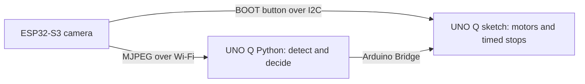

# Robocar: detect the ball and act on it

[All tracks](../README.md) · [Pre-work](PREWORK.md) · [Arduino references](PREWORK.md#arduino-references) · [Terminal commands](#terminal-commands) · [Driver API](#python-driver-api) · [Hardware reference](#hardware-and-camera-reference)

Use an Arduino UNO Q on a Hiwonder miniAuto chassis to find a ball, approach it, and push it toward a goal.

The robot arrives **preassembled**, including its ESP32-S3 camera. This guide starts with a short, button-started movement, then adds camera input and ball-driven behavior. The starter supplies motor control and camera firmware; you write the detector and decision logic.

Before connecting your kit, complete the [pre-work](PREWORK.md) (about 30 minutes).

## 1. Connect to the robot

You need a computer with [Arduino App Lab](https://docs.arduino.cc/software/app-lab/), a data-capable USB-C cable, and the robot's camera network details.

1. Raise the wheels and locate the motor-power disconnect. Keep wheels and cables clear.
2. Connect the UNO Q by USB and follow the [App Lab board connection guide](https://docs.arduino.cc/software/app-lab/configure/config/). Keep the prepared board software and wiring in place.
3. Get the camera SSID/password and motor calibration supplied with the robot. Locate the camera's **BOOT button**, which starts and stops the program.

The button is a software stop. Keep the physical motor-power disconnect accessible while developing movement.

## 2. Run the starter

For a terminal workflow, use [`make flash` and `make monitor`](#terminal-commands) below, then continue with the button-started movement here.

The App Lab application is the **`robocar/` folder**. Use the prepared app ZIP, or open a terminal in `robocar/` and run this with GNU Make and `zip` installed:

```sh
make package
```

Import `build/uno-q-robocar.zip` from this track folder. Without Make, create the archive from the same folder in a macOS/Linux terminal:

```sh
zip -r /tmp/uno-q-robocar.zip app.yaml python sketch -x '*/__pycache__/*' '*.pyc'
```

On Windows, ZIP `app.yaml`, `python/`, and `sketch/` with `app.yaml` at the archive root. Import the ZIP from **My Apps** in App Lab, select the UNO Q, and run it. Allow time for the first dependency download and compilation.

The robot stays still on startup. With the wheels raised, short-press and release **BOOT**. After the red/yellow/green countdown, it runs one forward pulse at speed `100` for `200 ms`, stops, and waits for another press.

[`python/main.py`](python/main.py) contains the routine you will extend:

```python
def motion_check() -> None:
    robot.drive("forward", speed=100, ms=200)
```

Keep the surrounding `robot.run_program(...)`, startup stop, and `finally` block. They provide the button-controlled run lifecycle. `robot.stop()` stops the motors **and ends the current run**; a new BOOT press is needed to start again.

Edit the imported files in App Lab, then stop and run the app again. For a terminal-managed app, edit the local checkout and run `make flash` again. For an imported app, package and import local changes again. Export the app to save your code and calibration together.

## 3. Open the camera stream



The camera has its own Wi-Fi access point. Install any Python vision packages while the UNO Q still has Internet access, then join the camera network from **UNO Q Linux**. Keep USB connected for App Lab; the camera network has no Internet access.

Join that network on your computer too, then open `http://192.168.5.1:81/` and start the preview. Place the ball near, far, left, and right to find a useful camera angle. Close the browser stream before using Python: the camera serves one active stream at a time.

To read the stream from the app without moving, temporarily replace `motion_check()` with this function. Leave the rest of `main.py` intact, run the app, and press BOOT:

```python
def motion_check() -> None:
    from urllib.request import urlopen

    with urlopen("http://192.168.5.1:81/stream", timeout=3) as stream:
        assert stream.headers.get_content_type() == "multipart/x-mixed-replace", "Expected MJPEG"
        assert b"\xff\xd8" in stream.read(1024), "Expected a JPEG frame header"
    print("Camera stream reached from the UNO Q app.")
```

This reads the stream header. Your detector will decode complete **320×240** frames from the same URL. Camera flashing and network settings are in the [camera reference](#camera-setup).

## 4. Tune short movements

Restore the original `motion_check()` and use the robot's supplied motor calibration. With the wheels raised, change its direction one at a time:

| Direction                     | Movement          |
| ----------------------------- | ----------------- |
| `forward`, `backward`         | Straight movement |
| `left`, `right`               | Lateral movement  |
| `rotate_left`, `rotate_right` | Turn in place     |

On a clear surface, find the lowest reliable speed and the distance or rotation produced by a short pulse. Begin around `100–200 ms`; record the speed, duration, surface, and battery condition. Keep movements bounded: **duration `0` requests continuous motion**.

A timed `drive()` stops its motor output and lets the routine continue. Use `robot.stop()` to end the run. Confirm that BOOT stops the routine during a pulse before adding autonomy. The [driver reference](#python-driver-api) lists the remaining methods and sensor fields.

## 5. Detect the ball with motors stopped

Keep the robot stationary while developing the detector. Put detector code in `python/` beside `main.py` and add its dependencies to `python/requirements.txt`.

For a distinctively colored ball, start with **OpenCV**: convert frames to HSV, threshold the ball's color, remove isolated pixels, and choose a contour using area and shape. Tune the color range from this camera under the actual lighting. `opencv-python-headless` provides OpenCV without a desktop window; install it through the app's requirements file before joining the camera network.

For a learned detector, collect and label frames from this camera, including empty scenes and similar-looking objects. Keep separate capture sessions for training and evaluation. A tool such as [Edge Impulse](https://docs.edgeimpulse.com/studio/projects/learning-blocks/blocks/object-detection) can provide the training workflow. Export for the UNO Q's Linux processor and match the model's input size and preprocessing.

Have either detector return the same useful information:

| Value                         | Purpose                              |
| ----------------------------- | ------------------------------------ |
| Ball found or absent          | Decide whether movement is allowed   |
| Horizontal center in pixels   | Steer toward the ball                |
| Detection quality             | Reject uncertain candidates          |
| Apparent size, when available | Estimate proximity after calibration |
| Frame arrival time            | Detect a stalled feed                |

Start by printing detections for a ball on the left, center, and right, then remove or briefly hide it. Compare the live scene with the output. Bound camera reads and inference time, consume the newest available frame, and stop on a stalled feed. A recent read timestamp alone does not rule out buffered, old images.

## 6. Add a controlled goal attempt

Replace `motion_check()` with your observation/action routine while keeping `robot.run_program(...)`. Start with the robot, ball, and goal aligned. Make one correction or approach pulse, acquire a new frame, and decide again.

| Observation                                 | Next action                              |
| ------------------------------------------- | ---------------------------------------- |
| Ball missing, uncertain, or stale           | Stop and end the run                     |
| Ball left or right of a center band         | Make a short steering correction         |
| Ball centered and path clear                | Move forward in a short pulse            |
| Ball close and aligned with the goal        | Push in a controlled pulse, then observe |
| Goal attempt finished or time limit reached | Stop and wait for another BOOT press     |

Use a center dead band to avoid constant left/right corrections, slow down near the ball, and set an overall run time limit. Check `robot.is_running()` inside loops that do not call `drive()` or `servo()`. Treat an ultrasonic reading of `-1` as unknown; leave the inherited obstacle-avoidance demo disabled.

Ball alignment and goal alignment are separate decisions. Use the supplied starting arrangement first, then add goal perception if your approach needs it. Print the chosen action beside each observation so you can tune the behavior.

Finish with a repeatable run: press BOOT, detect the ball, approach, attempt the goal, and stop. Save the source, launch steps, camera settings, motor calibration, and any model/data credits with your project. The [robocar rubric](../README.md#robocar-rubric) describes the complete result.

## Code map

| File                                                                                               | Role                                                         |
| -------------------------------------------------------------------------------------------------- | ------------------------------------------------------------ |
| [`python/main.py`](python/main.py)                                                                 | Button-started routine; add your perception and actions here |
| [`python/robot_client.py`](python/robot_client.py)                                                 | Python motor and sensor API                                  |
| [`sketch/sketch.ino`](sketch/sketch.ino)                                                           | Motor control, sensors, button handling, and timed stops     |
| [`sketch/sketch.yaml`](sketch/sketch.yaml)                                                         | UNO Q board and Arduino library dependencies                 |
| [`camera/HiwonderCamStream/HiwonderCamStream.ino`](camera/HiwonderCamStream/HiwonderCamStream.ino) | Separately flashed ESP32-S3 camera firmware                  |

## Terminal commands

After the board's initial setup, you can develop from a **macOS/Linux terminal** in `robocar/`. Install GNU Make, `zip`, and [Android SDK Platform-Tools](https://developer.android.com/tools/releases/platform-tools), with `adb` on your command path. The prepared UNO Q provides Python 3 and [Arduino App CLI](https://github.com/arduino/arduino-app-cli), which builds and runs both parts of the app.

```sh
make devices
make flash
make monitor
```

`make flash` copies this track's `app.yaml`, `python/`, and `sketch/` to `~/ArduinoApps/uno-q-robocar-cli` on the board, compiles and uploads the MCU sketch, and starts Python. The first run needs Internet access to download dependencies. Keep the wheels raised and the motor-power disconnect accessible. The camera is flashed separately.

After editing local files, run `make flash` again. It replaces those source paths, including edits made to that copy in App Lab, while preserving the app's `data/`, `.env`, and dependency cache. Save game data under `data/`, outside the replaced source folders. Other App Lab projects are left in place.

| Command        | Action                                                                                         |
| -------------- | ---------------------------------------------------------------------------------------------- |
| `make`         | List available commands                                                                        |
| `make devices` | List connected ADB devices                                                                     |
| `make flash`   | Deploy this track, upload its sketch, and start Python                                         |
| `make monitor` | Open the MCU serial monitor                                                                    |
| `make logs`    | Follow Python output, including `print()` and errors                                           |
| `make stop`    | Stop this track's terminal-managed app                                                         |
| `make package` | Create `build/uno-q-robocar.zip` for App Lab import                                            |
| `make build`   | Compile only the MCU sketch locally with [Arduino CLI](https://arduino.github.io/arduino-cli/) |
| `make clean`   | Remove this track's local ZIP and sketch build                                                 |

Use **Ctrl+C** to leave the monitor or logs; the app keeps running. Use `make stop` when finished. `make stop` is not a physical motor-power cutoff.

With one USB device connected, no board selection is needed. If several are connected, use the serial from `make devices` on each board command:

```sh
make flash SERIAL=YOUR_UNO_Q_SERIAL
make monitor SERIAL=YOUR_UNO_Q_SERIAL
make logs SERIAL=YOUR_UNO_Q_SERIAL
make stop SERIAL=YOUR_UNO_Q_SERIAL
```

Only one App Lab app can run at a time. If another app is running, stop it in App Lab or use a board terminal before flashing:

```sh
adb -d shell
TMPDIR=/tmp arduino-app-cli app list
TMPDIR=/tmp arduino-app-cli app stop APP_ID
exit
```

Replace `APP_ID` with its ID from the list. With multiple devices, replace `adb -d shell` with `adb -s YOUR_UNO_Q_SERIAL shell`. Tool paths can be overridden with `ADB=...` or `ARDUINO_CLI=...`; local Arduino CLI is needed only for `make build`.

## Python driver API

[`python/robot_client.py`](python/robot_client.py) calls the providers in [`sketch/sketch.ino`](sketch/sketch.ino). Run it within the UNO Q App Lab runtime.

| Method                                | Behavior                                                                                                                      |
| ------------------------------------- | ----------------------------------------------------------------------------------------------------------------------------- |
| `health()`                            | Returns the firmware identity and available interfaces.                                                                       |
| `read_sensors()`                      | Parses the sensor JSON; returns `{}` for an empty reply. Parsing/transport errors propagate.                                  |
| `is_running()`                        | Reads `program_enabled` from the sensor payload.                                                                              |
| `run_program(routine)`                | Runs the routine when enabled, catches `ProgramStopped`, and calls `stop()` on completion or exception.                       |
| `drive(direction, speed=150, ms=500)` | Requires an enabled program, calls firmware, waits `ms / 1000 + 0.1` seconds, and checks the run state again. Returns `None`. |
| `stop()`                              | Stops motors, disables obstacle avoidance, and **disables the current program**. Returns a boolean.                           |
| `drive_raw(m0, m1, m2, m3, ms=500)`   | Requires an enabled program and sends individual motor inputs. Returns immediately, without the wait used by `drive()`.       |
| `servo(angle)`                        | Requires an enabled program; firmware clamps to `0..180`. Verify the physical travel limits of the fitted gripper first.      |
| `led(on)`, `buzz()`                   | Operate the lights/buzzer and return a boolean.                                                                               |
| `hold_toggle()`                       | Reads the camera's long-press toggle; unused by the track behavior.                                                           |

Named directions are `forward`, `backward`, `left`, `right`, `rotate_left`, `rotate_right`, and `stop`. Left/right are lateral movement requests. An unknown direction produces no new movement in firmware, but the Python wrapper does not return that rejection. Use the documented names.

Firmware clamps named speed to an absolute `0..255`, raw inputs to `-255..255`, and duration to `0..5000 ms`. **Duration `0` means continuous movement.** Pass small positive durations from Python; its wait uses the supplied duration, not the firmware-clamped value. Never depend on a Python `finally` block as the only motor stop: process termination or a lost Bridge connection can prevent it from executing, while the MCU's timed stop remains available if its loop is running.

`robot.stop()` ends the program; `robot.drive("stop", speed=0, ms=100)` stops motor output while retaining the enabled program. For a camera or perception fault, prefer ending the run and requiring a deliberate restart.

### Sensor payload

| Field                            | Meaning                                                                                   |
| -------------------------------- | ----------------------------------------------------------------------------------------- |
| `program_enabled`                | Whether the Python-controlled program is enabled                                          |
| `hold_toggle`                    | Camera hold state, unused by the track                                                    |
| `line_ok`                        | Whether the line sensor read succeeded                                                    |
| `line_digital`, `trace_digital`  | Same four line bits for compatibility; zeroed on read failure, so inspect `line_ok`       |
| `ultrasonic_mm`, `ultrasonic_cm` | Distance, or `-1` on read failure                                                         |
| `battery_mv`                     | Estimate using the upstream A3 calibration factor; verify against the actual power system |
| `ir`                             | Reserved compatibility field, always `-1`                                                 |

### Serial diagnostics

Open `make monitor` from this track folder. The sketch initializes its serial interface at `9600` baud. Start with read-only commands: `?` for help, `health` for interface identity, and `read_sensors` for current data.

With raised wheels, `drive forward 100 200` requests a short pulse. `stop` or `x` stops motors and obstacle avoidance, but **does not disable the Python program** in the inherited serial handler; an active Python routine could issue another command. For a full application stop use the camera short press, `robot.stop()`, or stop the app. Use the physical disconnect if needed.

Serial motor commands bypass the Python start gate. The `1`–`4` motor tests and `dir_sweep`, `dir_scan`, `combo_scan`, and `pwm_combo` diagnostics physically move outputs, and some block the main loop. Run them only during supervised calibration with raised wheels. Do not combine them with an autonomous routine. Do not enable the inherited `F|1|&` obstacle demo for this track; invalid ultrasonic readings cause it to drive forward.

## Hardware and camera reference

The robot and camera are supplied preassembled. Use this section when preparing or maintaining a unit. Keep motor calibration specific to its chassis and provide the camera network details with the robot.

### UNO Q connections

| Component                               | UNO Q pin or bus                  |
| --------------------------------------- | --------------------------------- |
| Motor PWM channels M0, M1, M2, M3       | D10, D9, D6, D11                  |
| Motor direction channels M0, M1, M2, M3 | D12, D8, D7, D13                  |
| RGB data                                | D2                                |
| Passive buzzer                          | D3                                |
| Servo/gripper, if fitted                | D5                                |
| Battery divider                         | A3                                |
| Ultrasonic sensor                       | Header I2C `Wire`, address `0x77` |
| Four-channel line sensor                | Header I2C `Wire`, address `0x78` |
| Updated camera BOOT button interface    | Header I2C `Wire`, address `0x79` |

The sketch uses the UNO Q's header I2C bus. Refer to the [UNO Q manual](https://docs.arduino.cc/tutorials/uno-q/user-manual/) and [pinout](https://docs.arduino.cc/resources/pinouts/ABX00162-full-pinout.pdf) for the board wiring. Match signal levels and the motor board's power arrangement before connecting components.

The camera firmware uses **GPIO47 for SDA and GPIO48 for SCL** for its button interface. Connect these to the robot's corresponding header I2C signals, with common ground and compatible power/logic levels. The camera's internal image-sensor bus uses different pins. Disconnect power before adjusting the harness.

The sketch maps logical M0–M3 to board connectors M3, M2, M1, M4. Verify forward and reverse on every wheel before using mecanum movement, and record the calibrated map and polarity for the assembled chassis.

For mechanical assembly and battery handling, consult [Hiwonder's miniAuto guide](https://docs.hiwonder.com/projects/miniAuto/en/latest/docs/1.getting_ready.html). Its stock controller instructions do not replace the UNO Q pin and firmware setup here.

### Camera setup

The firmware is [`camera/HiwonderCamStream/HiwonderCamStream.ino`](camera/HiwonderCamStream/HiwonderCamStream.ino), for **Hiwonder ESP32S3-CAM V1.0 with GC2145**. Open that exact sketch in Arduino IDE; it is separate from the UNO Q application.

#### Toolchain and flash settings

Use **esp32 by Espressif Systems 2.0.11** with the settings below for the GC2145 camera firmware.

| Arduino IDE setting | Value                                            |
| ------------------- | ------------------------------------------------ |
| Board               | ESP32S3 Dev Module                               |
| PSRAM               | OPI PSRAM                                        |
| Flash Size          | 8MB (64Mb)                                       |
| Partition Scheme    | Huge APP (3MB No OTA/1MB SPIFFS)                 |
| USB CDC On Boot     | Disabled                                         |
| Flash Mode          | DIO                                              |
| Upload Speed        | 921600                                           |
| Port                | The camera's USB serial port, not the UNO Q port |

1. Set `CAMERA_SSID` uniquely for each robot. The source default is `miniAuto_CAM_01`.
2. Set `CAMERA_PASS` to the agreed camera password of at least eight characters. Replace the source default with the password you will supply with this robot.
3. Upload with the settings above, then power-cycle the camera.
4. Join its access point and open `http://192.168.5.1:81/`. Start the preview; consumers use `http://192.168.5.1:81/stream`.
5. Repeat the network check from the UNO Q Linux side. Keep USB access while switching networks, since the camera AP provides no Internet route.

The firmware captures **320×240 RGB565**, converts frames to JPEG at quality 80, and serves MJPEG on port 81. It uses two PSRAM frame buffers and a 15 MHz XCLK.

| Camera signal | ESP32-S3 GPIO | Camera signal | ESP32-S3 GPIO |
| ------------- | ------------: | ------------- | ------------: |
| PWDN          |            -1 | RESET         |            -1 |
| XCLK          |            15 | PCLK          |            13 |
| SIOD/SDA      |             4 | SIOC/SCL      |             5 |
| Y2            |            11 | Y3            |             9 |
| Y4            |             8 | Y5            |            10 |
| Y6            |            12 | Y7            |            18 |
| Y8            |            17 | Y9            |            16 |
| VSYNC         |             6 | HREF          |             7 |

#### Camera button behavior

GPIO0 is the camera BOOT button. Its I2C reply at `0x79` contains a short-press flag and a hold-toggle state. A read acknowledges the press flag.

- A short press and release starts the UNO Q program after its roughly 1.2-second red/yellow/green countdown, or disables it if already running.
- A five-second hold changes `hold_toggle` and the red/blue status indication. The robocar challenge does not use this toggle.
- `program_enabled` in the sensor payload reports the run state. The Python wrapper checks it before `drive()` and `servo()`, and after a timed `drive()`.

The button is a software input, not a hard power cutoff. Blocking firmware routines can delay its handling. Keep physical motor-power disconnection available.

## Edge Impulse: train a detector

Use this section to build and export the `.eim` model used in step 5. You can clone [our project with prelabelled capture data](https://studio.edgeimpulse.com/public/1144501/live) or start from scratch with your own captures.

Before joining the camera network (no internet on ESP32 connection), add the Edge Impulse Linux runner to `python/requirements.txt` while the UNO Q still has Internet access:

```
edge-impulse-linux
```

App Lab installs it on first run. The package provides `ImageImpulseRunner`, which loads and invokes the `.eim` file.

 You can also sign into your Edge Impulse account on Arduino App Lab by navigating to the **Add Brick** icon on the top left, scroll down to **Video Object Detection**, and select **AI Models** and scroll one more time down to **Train new AI Model on Edge Impulse**. This will prompt a sign in screen, and once connected your project/model will be available for selection.

### 1. Collect data

Go to **Data acquisition** in the left sidebar and click **+ Add data → Collect new data**. Select **Scan QR code to connect to your phone** and follow the on-screen directions to capture images from your phone's camera.

For the robocar challenge you need at least two classes: `soccerball` and `goal`. Capture each from different angles, distances, and lighting conditions. Include empty scenes and background-only frames to reduce false positives.

### 2. Create impulse

Navigate to **Create impulse**. Use these settings:

**Image data**

| Setting              | Value  |
| -------------------- | ------ |
| Image width          | 96     |
| Image height         | 96     |
| Resize mode          | Squash |
| Train on data subset | 100%   |

**Processing block** — add **Image** (required; training will error without it).

**Learning block** — add **Object Detection (Images)**. Select FOMO MobileNetV2 0.35 (Optimized data augmentation) and confirm the output features match your label count: `soccerball` and `goal`.

Click **Save impulse**.

### 3. Generate features

Navigate to **Image** under **Impulse design**. Set color depth to **RGB**, click **Save parameters**, then **Generate features**. Review the feature explorer to confirm class separation before training.

### 4. Train the model

Navigate to **Object detection** under **Impulse design**.

| Setting                   | Value   |
| ------------------------- | ------- |
| Number of training cycles | 150–180 |
| Learning rate             | 0.001   |
| Training processor        | CPU     |
| Data augmentation         | Enabled |

Click **Save & train**. Review the F1 score and confusion matrix in the Training output panel. On-device performance on the Arduino UNO Q runs around 8 ms latency, 133 kB RAM, and 81 kB flash.

### 5. Export and place the model

Navigate to **Deployment**, set the deployment target to **Arduino UNO Q**, and click **Build**. Download the `.eim` file and place it in your project:

```
python/
  your-model-linux-aarch64.eim
```

The `.eim` file is generated from your own project and is not included by default. You can also use the Arduino App Lab **Video Object Detection** brick mentioned before step 1.
